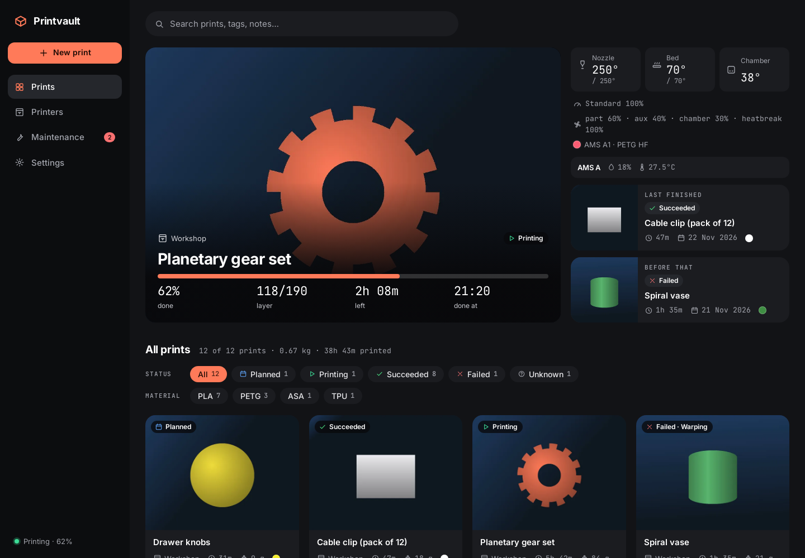
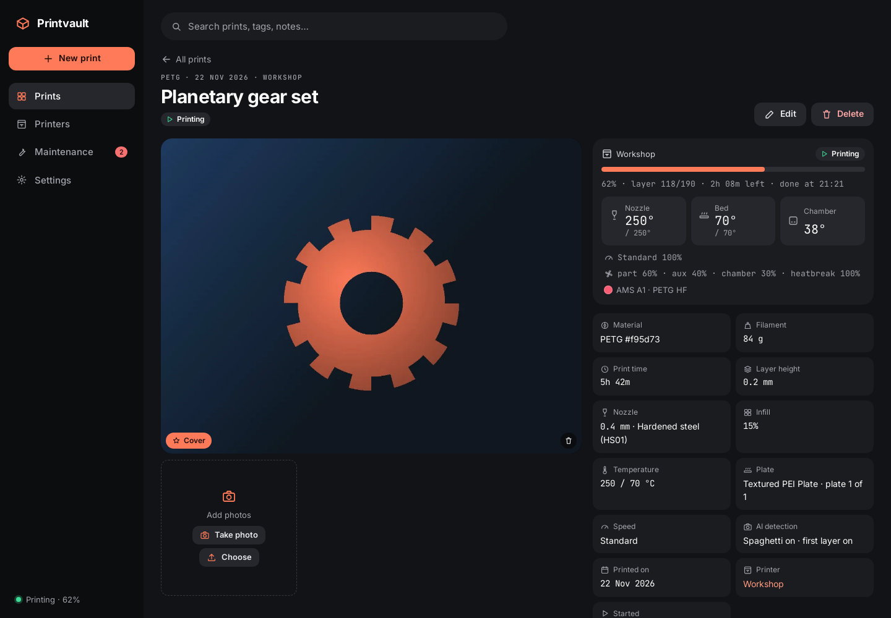
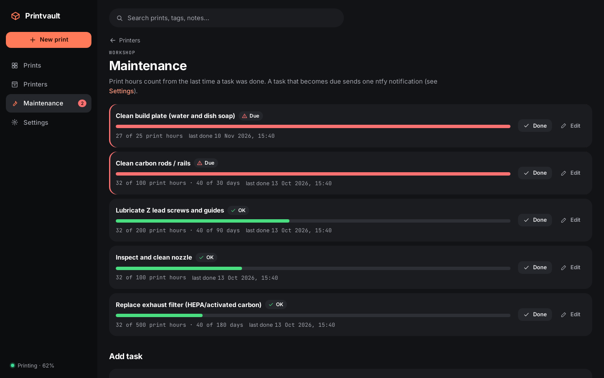
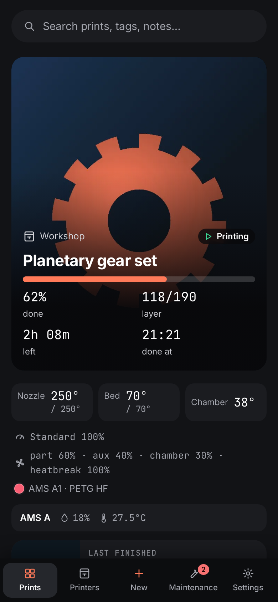

# Printvault

[](https://github.com/emphyri0/printvault/actions/workflows/tests.yml)

A self-hosted archive for your 3D prints: photos, model files, filament, print time, settings and notes, with a live, **read-only** connection to Bambu Lab printers over the local network.

> [!WARNING]
> **Printvault has no login.** Anyone who can reach it can see, change and delete everything, and watch the printer camera. Only run it on a network you trust (your home LAN, a VPN such as WireGuard or Tailscale), never directly on the internet. Put it behind a reverse proxy with authentication if you need more.



| Print detail with temperature chart | Maintenance | Phone |
|---|---|---|
|  |  |  |

*Screenshots from a demo database with made-up prints and generated images.*

## Features

- **Prints** with photos, model files (3mf, stl, step, obj, gcode), material, filament colours, weight, print time, slicer settings, tags and notes. Search and filter chips (status, fail reason, material, nozzle, printer).
- **Import** from a MakerWorld link (title, designer, cover, filament, weight, print time) or from a sliced 3MF/G-code (name, material, weight, time, thumbnail, slicer settings).
- **Live connection with Bambu Lab printers** (MQTT, read-only): prints are created and closed automatically, with the AMS slots used; the home page shows the running print large at the top, like the printer screen: stage, progress, finish time, temperatures, speed, fans, active filament, AMS humidity.
- **Camera**: live image, a refreshed image on the card of a running print, and an automatic camera photo on the print when it finishes or fails.
- **Temperature and stage chart** per print.
- **Error codes** (print_error and HMS) as readable text with a link to the Bambu wiki, and a suggested fail reason.
- **Maintenance** tasks per printer with an interval in print hours and/or days.
- **Notifications** via [ntfy](https://ntfy.sh): print finished, print failed, maintenance due.
- **Print again**: open the 3MF in Bambu Studio or the model on MakerWorld (nothing is sent to the printer).
- Dark, image-first interface that works on a phone; no framework, no build step, no requests to other sites.

## Installation

Requirements: Docker with the compose plugin.

```bash
git clone https://github.com/emphyri0/printvault.git
cd printvault
cp .env.example .env        # set SECRET_KEY (see the comment in the file)
mkdir -p data
docker compose up -d --build
```

Printvault now runs on port **8100** of that machine: `http://<host>:8100`. Two containers start: `printvault` (the web app) and `printvault-mqtt` (the listener for the printers).

`docker-compose.yml` publishes the port on all interfaces (`0.0.0.0:8100`) so other devices on your LAN can use it. To limit it to the machine itself (e.g. behind a reverse proxy on the same host), change that line to `127.0.0.1:8100:5000`. See the warning above.

Updating: `git pull && docker compose up -d --build`. The database is migrated automatically.

### Configuration

All settings are in `.env` (see `.env.example`):

| Variable | Default | Meaning |
|---|---|---|
| `SECRET_KEY` | *(required)* | Long random string for the session cookie |
| `MAX_UPLOAD_MB` | `200` | Maximum upload size |
| `PRINTVAULT_TZ` | `Europe/Brussels` | Time zone for print times and maintenance |
| `CAMERA_FPS`, `CAMERA_WIDTH` | `5`, `1280` | Live image of RTSPS cameras |
| `TRUSTED_PROXIES` | `0` | Number of reverse proxies in front of the app (see below) |
| `UID`, `GID` | `1000` | User and group the containers run as (owner of `./data`) |

Notifications (ntfy server, topic, optional token) are set in the app under **Settings**.

### Data and backups

Everything is in `./data`: the SQLite database `printvault.db`, the uploads in `uploads/` and their thumbnails in `uploads/thumbs/`. Back up that folder and you have everything; the thumbnails can be deleted and are rebuilt at the next start.

## Connecting a Bambu Lab printer

Under **Printers → Add printer**, choose the model, fill in the IP address, serial number and access code (on the printer: *Settings → Network/WLAN*) and tick *Live connection on*. The listener re-reads the settings every minute; no restart needed.

### Read-only

Printvault only **listens**: it connects to the printer's local MQTT broker (`mqtts://<ip>:8883`, user `bblp`, password = access code, TLS without certificate verification, as the printer has a self-signed certificate) and subscribes to `device/<serial>/report`. It never publishes anything, so it cannot start, stop or change a print. On the P2S this works with the printer in normal cloud mode; LAN-only mode or developer mode is not needed for reading the status.

- `PREPARE`/`RUNNING` → a print with status *Printing*; `FINISH` → *Succeeded*; `FAILED` → *Failed* with the printer's error code.
- At the start of a print, empty fields are filled in: nozzle diameter and type, plate, plate x of y, speed profile, spaghetti detection and first layer inspection. What you filled in yourself is kept.
- If the listener restarts during a print, the print is resumed (recognised by `task_id`). If it missed the end, the print gets status *Unknown*.
- AMS humidity and temperature are stored at most every 10 minutes per unit.
- Log: `docker compose logs -f printvault-mqtt`.

### Camera and LAN Only Liveview

For the camera, enable **LAN Only Liveview** on the printer, in its network settings (the exact name differs a little per model and firmware). Depending on the model, Printvault uses one of two routes:

- **RTSPS on port 322** (X1, H2 and P2 series): ffmpeg in the container converts the stream into JPEGs, ± 5 fps.
- **JPEG stream on port 6000** (A1 and P1 series): after a login packet over TLS the printer sends complete JPEGs, about one every 1–2 seconds; read in Python. Protocol after [ha-bambulab](https://github.com/greghesp/ha-bambulab) (MIT), `ChamberImageThread` in `pybambu/bambu_client.py`.

There is one camera connection per printer, shared by all viewers, and it stops 15 seconds after the last viewer leaves. Single images are cached for 20 seconds, so several open tabs do not load the printer. The access code never appears in logs or error messages.

### Supported models

The model decides the camera route; the MQTT connection is the same for all models. Fields a model does not send (a chamber temperature on the A1/P1, the aux fan on the A1, …) are simply left out.

| Model | Camera | Status fields | Tested on hardware |
|---|---|---|---|
| P2S | RTSPS, port 322 | packed `device.*` temperatures, chamber, fans, speed, stage, AMS 2 Pro | **yes** |
| X1, X1C, X1E | RTSPS, port 322 | `nozzle_temper`/`bed_temper`/`chamber_temper` as plain numbers (older firmware) or packed; `vt_tray` external spool | no |
| H2D, H2D Pro, H2C | RTSPS, port 322 | both nozzles (current/target, active one marked), packed temperatures, `device.ctc` chamber | no |
| H2S | RTSPS, port 322 | packed temperatures, `device.ctc` chamber | no |
| P1P, P1S | JPEG stream, port 6000 | plain-number temperatures, no chamber temperature | no |
| A1, A1 mini | JPEG stream, port 6000 | plain-number temperatures, no chamber temperature or aux/chamber fan | no |
| Other | chosen by hand: RTSPS, JPEG stream or none | whatever the printer sends in the known formats | no |

"No" means: built after the report formats and camera split per model documented in [ha-bambulab](https://github.com/greghesp/ha-bambulab) (`pybambu/models.py`) and covered by tests with report fragments in those formats (`tests/test_models.py`), but never run against such a printer. Reports of what works and what does not are very welcome (open an issue).

## Using it

- **Print again** (detail page): *Open in Bambu Studio* opens the newest 3MF of the print through Bambu Studio's own URL scheme (`bambustudio://open?file=<url>`, on macOS `bambustudioopen://<url>`, from Bambu Studio's source). Bambu Studio then downloads the file from Printvault, so that computer must reach Printvault at the address in the browser; Bambu Studio first asks whether to open a file from this site. Without Bambu Studio (or on a phone) the 3MF is downloaded instead. *Open on MakerWorld* opens the model page, from where you can print with the Bambu Handy app.
- **Maintenance** (*Printers → Maintenance*): tasks with an interval in print hours and/or days; a task is due at whichever comes first. A printer without tasks offers a button to add a set of default tasks (written for the P2S; adjust the intervals). A task that becomes due sends one ntfy notification.
- **Notifications** (*Settings*): ntfy server, topic and optional token, on/off per kind; *Send test notification* checks the settings. On the public ntfy.sh server anyone who knows the topic can read along: choose a long, random topic or use your own server with a token.
- **Error codes**: texts and wiki links in `bambu_errors_data.json`, generated from ha-bambulab with `python3 scripts/update_bambu_errors.py` (optionally `--ref <sha>`); own texts and suggested fail reasons in `bambu_errors.py`.

### Photos and thumbnails

Every photo gets two WebP versions (600 px for cards, 1600 px for the detail page), made with ffmpeg in the background. Images are only scaled down, the EXIF orientation is applied, and the thumbnails contain no metadata (no EXIF, GPS or XMP). The originals are stored unchanged and stay downloadable. Of an animated GIF the thumbnail is the first frame; the animation is only shown on the detail page.

### Behind a reverse proxy

Absolute links (such as the download URL for Bambu Studio) use the scheme and host of the request. Behind a reverse proxy that terminates HTTPS, set `TRUSTED_PROXIES=1` (the number of proxies) so the app reads `X-Forwarded-Proto` and `X-Forwarded-Host` through werkzeug's `ProxyFix`. Caddy and Traefik send those headers by default; nginx needs `proxy_set_header X-Forwarded-Proto $scheme;` and `proxy_set_header X-Forwarded-Host $host;`. Only switch it on when the app can be reached exclusively through the proxy; otherwise anyone can send fake headers and make Printvault build links to another host.

## Development

```bash
python3 -m venv venv && . venv/bin/activate
pip install -r requirements.txt
python app.py                     # http://127.0.0.1:8100
python mqtt_listener.py           # second terminal; live status at http://127.0.0.1:8101/live
python -m unittest discover -s tests
```

The thumbnail tests need ffmpeg and are skipped without it (with `REQUIRE_FFMPEG=1` they fail instead, as in CI). Everything in the image, with ffmpeg and without network:

```bash
docker run --rm --network none -u "$(id -u):$(id -g)" -e PYTHONDONTWRITEBYTECODE=1 -e DATA_DIR=/tmp/pvtest \
  -v "$PWD":/src:ro -w /src --entrypoint python printvault:local -m unittest discover -s tests
```

GitHub Actions (`.github/workflows/tests.yml`) and Forgejo Actions (`.forgejo/workflows/tests.yml`) run the tests on every push and pull request, with the same steps in a `python:3.12-slim` container with ffmpeg.

Notes for contributors:

- Internal values are lowercase snake_case, shown through `LABELS` in `app.py` (status: `planned`, `printing`, `succeeded`, `failed`, `unknown`, `reprint`; fail reason: `adhesion`, `warping`, `spaghetti`, `clog`, `power_loss`, `other`; speed profile: `silent`, `standard`, `sport`, `ludicrous`; printer models in `bambu_models.py`).
- Front end: plain HTML, CSS and JavaScript in `templates/` and `static/`; own inline SVG icons in `icons.py`; Inter and JetBrains Mono self-hosted in `static/fonts/`.
- Accessibility: a status is always an icon plus a word, never colour alone; visible focus; text contrast at least 4.5:1, form field borders at least 3:1; the chart colours are checked for colour blindness and have direct labels and a table.
- The raw report fields are translated in `bambu_status.py`; missing fields must simply drop out.

## Credits and licence

Printvault is released under the [MIT License](LICENSE).

- [ha-bambulab](https://github.com/greghesp/ha-bambulab) (MIT, © ha-bambulab contributors): source of the error code texts and stage names (which in turn come from Bambu Lab and the [HMS wiki](https://wiki.bambulab.com/en/hms/home)), the model information (camera route and report formats per model) and the camera protocol on port 6000.
- Fonts: [Inter](https://rsms.me/inter/) and [JetBrains Mono](https://www.jetbrains.com/lp/mono/), SIL Open Font License 1.1 (`static/fonts/`).

Bambu Lab, Bambu Studio, Bambu Handy and MakerWorld are trademarks of their owners. Printvault is an independent project, not affiliated with or endorsed by Bambu Lab.
